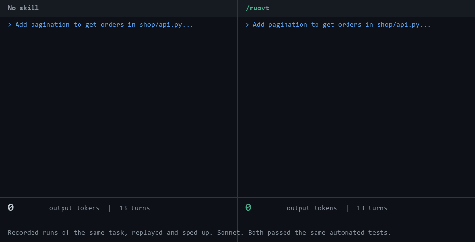

# muovt

A [Claude Code](https://claude.com/claude-code) skill that makes the agent do the work and answer with one word: `done`.



muovt is based on [Caveman](https://github.com/JuliusBrussee/caveman) by Julius Brussee, and is not affiliated with it. Caveman keeps the explanation and makes it shorter. muovt drops the explanation when you asked for an action, and adds rules that limit what the agent reads and does.

## What it does

Once you type `/muovt`, it stays on for the session, until you say "stop muovt" or "normal mode".

| You send | You get |
|---|---|
| A task | `done`, or `fatto` if you wrote in Italian |
| A question | Only the answer, in as few words as possible |
| A task that fails or only partly works | What is wrong, in one line |
| `/muovt` with no task | A one-line question asking what to do |

It only changes the chat. Code, comments, commits and docs are written normally.

The agent also follows these rules:

- **It reads less.** It goes straight to named files, searches before reading, and reads only the lines it needs.
- **It does less.** It adds no unrequested cleanup, tests or docs, and it uses one command for a change across many files.
- **It checks once.** It runs the smallest check that covers the change, then stops.

## Results

Each setup ran the same 5 coding tasks: 13 runs per setup, on Sonnet, with the same prompts and permissions. Every run passed the automated checks for its task.

| Setup | Output tokens | Text written in chat | Cost |
|---|---:|---:|---:|
| No skill | 15,295 | 6,822 characters | baseline |
| **muovt** | **9,697 (-37%)** | **52 characters (-99%)** | **-18%** |
| `/caveman` | 15,095 (-1%) | 5,387 characters (-21%) | +1% |
| `/ultracave` | 15,094 (-1%) | 4,653 characters (-32%) | +4% |

Cost is calculated with every input token at the cache-read price, plus output tokens at the output price. Cache writes are left out because they depend on the order the runs happen in, not on the skill. You pay for those writes in real use, so a real bill will probably drop by less. Per-run data is in [`benchmark/results.csv`](benchmark/results.csv).

The savings are not evenly spread:

| Task | Cost compared with no skill |
|---|---:|
| Fix a typo | -2% |
| Add docstrings to 3 functions | 0% |
| Rename a function across files | -9% |
| Add pagination and update its callers | -25% |
| Find and fix a rounding bug | -39% |

On very small tasks, muovt saves almost nothing. Most of the cost there is the context the agent loads at the start, which muovt doesn't change.

## Limits

- **This is a small test.** It used small tasks, one model, and sessions of a single prompt. The two larger tasks ran only twice per setup, and long sessions were not measured.
- **This doesn't show muovt beats Caveman.** The test covers Caveman's two skills only. Caveman reports its largest savings from its proxy and model selection, which were not tested. Its skills also keep the explanation, which muovt throws away.
- **`done` is the agent's own claim.** You get no report to check it against, so review the result with `git diff` or by running your code.
- **Don't rely on it to stop a delete.** muovt has a rule to confirm irreversible actions first, but in one test `/muovt delete the locales folder` deleted the folder without asking. The folder was tracked by git.

## Install

Clone it into your personal skills, so it works in every project:

```bash
git clone https://github.com/Nduli96/muovt ~/.claude/skills/muovt
```

To use it in one project only, copy `SKILL.md` to `.claude/skills/muovt/` inside that project.

Then type `/muovt` followed by what you want done.

## License

Apache-2.0, because muovt is based on Caveman. See [LICENSE](LICENSE), [LICENSE-MIT](LICENSE-MIT) and [NOTICE](NOTICE).
